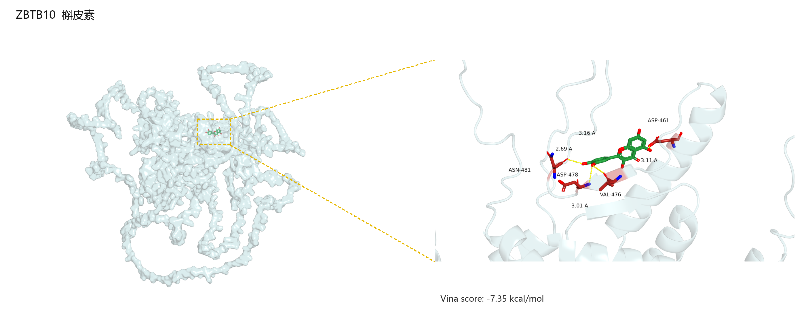

# DockingSkill

从人源基因缩写和小分子名称出发，获取结构、预处理、进行全蛋白盲对接，
并通过本地 PyMOL 和 PLIP 生成可追溯的结构可视化。

**必须先检查本机是否具备整个工作流所需的工具。必需工具检查通过后，才能进行后续操作。**
本项目不是免安装软件，不包含 Python 环境、Vina 二进制程序或数据库结构。



## 1. 先检查本地工具

当前实现针对 Windows / PowerShell，默认使用 D 盘工作区。
推荐 Python 3.11；脚本最低检查版本为 3.10，实际验证版本为 3.11.15。

| 组件 | 用途 | 默认完整流程是否必需 |
| --- | --- | --- |
| AutoDock Vina | 对接与评分，验证版本 1.2.7 | 是 |
| RDKit、Meeko、Gemmi、Biopython | 化学结构与受体预处理、构象导出 | 是 |
| NumPy、SciPy、Pandas、PyYAML | 计算、表格与配置 | 是 |
| PyMOL、PLIP、OpenBabel、lxml、Pillow | 原生渲染、相互作用识别与排版 | 是 |
| P2Rank / Java | 显式局部口袋流程 | 默认全蛋白模式不需要 |

复用本机已有环境，不要直接重复安装。如果环境位置不同，先指定解释器，
并修改 `config.yaml` 中的 Vina / 可选 P2Rank 路径：

```powershell
cd D:\ChatGPT
git clone https://github.com/Zquan0910/dockingskill.git
cd D:\ChatGPT\dockingskill

# 如果本机已有环境不在默认位置，设置为实际的 python.exe：
# $env:DOCKINGSKILL_PYTHON = 'D:\your-environment\python.exe'

powershell -NoProfile -ExecutionPolicy Bypass -File .\scripts\run.ps1 doctor --local-only
```

**只有出现 `Local toolchain: HEALTHY`，才能继续下一步。** 缺少组件时先停止，
根据诊断逐项补齐后重新检查；Skill 不会自动安装或降低流程要求。
`dock` / `batch`（含别名）启动时会自动重复本地工具检查，失败即退出，
不会开始下载结构、预处理或对接。直接调用 Python 脚本/API 时，调用者必须先运行同样的检查。

`environment.yml` 记录已验证的依赖版本，不是跨平台锁文件，也不是“已经安装好”的证明。
新建环境前应先检查本地现状，并把环境、包缓存及临时目录设在 D 盘；详见
[故障排查](references/troubleshooting.md)。

默认 Python 环境为 `D:\GeneProteinDocking\env`；默认 Vina 路径在
`D:\ChatGPT\geneprotein-dock-runs\tools`。其他机器必须检查并调整这些路径。

## 2. 检查联网服务

```powershell
powershell -NoProfile -ExecutionPolicy Bypass -File .\scripts\run.ps1 doctor
```

这一步额外检查 UniProt、RCSB PDB、PubChem 和 AlphaFold 服务。
本地工具通过不代表网络一定可用；名称检索需要相关数据库连通。
网络警告与本地缺库分开报告，提供本地结构时不必依赖所有数据库在线。

## 3. 单次或批量对接

```powershell
powershell -NoProfile -ExecutionPolicy Bypass -File .\scripts\run.ps1 dock --gene ZBTB10 --compound "槲皮素"

# 本地结构也受支持；链和配体身份须明确：
powershell -NoProfile -ExecutionPolicy Bypass -File .\scripts\run.ps1 dock --gene ZBTB10 --protein "D:\input\target.pdb" --chain A --ligand "D:\input\ligand.sdf"

# 按 assets/batch_template.csv 的列填写自己的任务表：
powershell -NoProfile -ExecutionPolicy Bypass -File .\scripts\run.ps1 batch "D:\input\jobs.csv"
```

- 默认物种为人。优先选择目标链序列覆盖度和一致性均至少 95% 的实验结构，否则使用完整 AlphaFold 模型并记录预测来源和置信度。
- 支持中英文小分子名称、PubChem CID、SMILES 和 SDF；名称歧义时需明确具体结构。
- 记录清理、金属保留、补氢、构象生成与优化过程；不声称做了 pH 微观状态枚举或缺失片段建模。
- 默认根据最终受体 PDBQT 的全部原子坐标计算盒子：中心为各轴极值中点，边长为坐标跨度加 10 Å，两侧各留 5 Å，无 30 Å 上限。
- 默认 `exhaustiveness=64`、10 个构象、5 kcal/mol 能量窗口；单次与批量一致。失败时不自动缩小盒子或降低搜索强度。
- 参数优先级：命令行 > `config.yaml` > 内置默认值。续跑核对结构、参数指纹及结果校验和，不仅看任务名。

结构获取、预处理和结果说明见 [完整工作流](references/workflow_guide.md)；
局部模式和盒子规则见 [盒子策略](references/pocket_selection.md)。

## 4. 原生 PyMOL 出图

对接成功后默认自动出图；也可以只重新渲染已有成功结果，不重跑对接：

```powershell
powershell -NoProfile -ExecutionPolicy Bypass -File .\scripts\run.ps1 render "D:\ChatGPT\geneprotein-dock-runs\work\your-job-directory"
```

出图前检查本地 PyMOL，随后导入真实对接结构，在 PyMOL 内标注和光线追踪导出。
左侧为浅青色蛋白表面，用黄色虚线框标出配体位置，并连接右侧局部放大图。
两图无黑色外边框，保持各自原始宽高比。配体碳骨架为绿色，相互作用残基碳骨架为红色。
右侧只标氢键长度及所展示的蛋白残基名称/编号；文字背景透明，不后贴白底文字框。

只绘制 PLIP 实际识别且经坐标核对的氢键，不伪造相互作用。
输出 PNG、汇总 PDF、可编辑 PyMOL 会话、复现脚本与相互作用明细。
渲染失败单独报告，不把失败图片冒充成功结果。

## 文件与使用方式

| 路径 | 内容 |
| --- | --- |
| `SKILL.md`、`agents/openai.yaml` | 标准 Skill 入口和元数据 |
| `scripts/`、`scripts/tests/` | 工作流、检查、渲染及测试 |
| `config.yaml`、`environment.yml` | 默认参数、工具路径和依赖版本快照 |
| `references/` | 工作流、盒子和故障排查 |
| `assets/` | 已认可的参考图和批量输入模板 |

所有任务、缓存、临时文件和日志默认保存在 `D:\ChatGPT\geneprotein-dock-runs`，
不写入 Skill 源码目录，也不向 C 盘安装 Skill。这个仓库不自动注册到 Codex 的技能列表。
可以让支持本地 Skill 的代理先读取 `D:\ChatGPT\dockingskill\SKILL.md` 再使用。

## 验证与边界

```powershell
$env:PYTHONDONTWRITEBYTECODE = '1'
& D:\GeneProteinDocking\env\python.exe -B -m unittest discover -s .\scripts\tests
```

已在本地验证 ZBTB10＋槲皮素链路，以及既有构象的原生渲染。
示例图不是所有输入均适用的固定结果。大蛋白全包围盒耗时更长，搜索仍存在不确定性。
AlphaFold 低置信区的构象需谨慎解释。

评分应称为 **Vina 对接评分（kcal/mol）**，不是实验结合自由能或已证实的结合。
不要凭固定分数阈值判定强结合；批量比较应按靶点分组。

## 许可证

本仓库原创脚本和文档采用 [MIT License](LICENSE)。第三方工具、库和数据库数据
仍受各自许可证及使用条款约束；本仓库不重新授权或分发其安装包。
